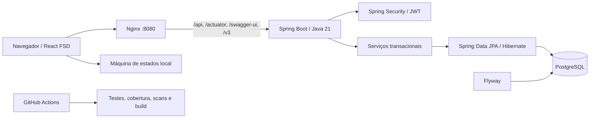
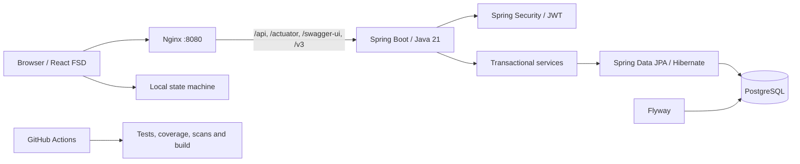

# Arquitetura / Architecture

### 🇧🇷 Descrição em Português

<strong>Ver Detalhes</strong>

## Visão geral
O sistema é um monorepo com SPA React, API Spring e PostgreSQL. A mesma origem no Nginx simplifica cookies, CORS e implantação. O Studio é um simulador educacional local; o catálogo, usuários e dashboard usam a API real.

## Separação de responsabilidades
Controllers traduzem HTTP e validam DTOs; services aplicam regras e transações; repositories usam JPA; mappers produzem contratos sem expor entidades. PostgreSQL garante unicidade de ISBN/e-mail e consistência das quantidades. A checagem prévia melhora o erro de negócio, mas a constraint resolve cadastros concorrentes.

Frontend segue `app → pages → widgets → features → entities → shared`. Query mantém estado remoto; RHF/Zod validam formulários; a sessão mantém apenas access token em memória. O refresh é compartilhado entre requisições concorrentes. A máquina do workflow não depende do React Flow: a renderização deriva dos eventos e do estado.

O painel de evidências apresenta três estados independentes: relatórios coletados em `frontend/public/evidence.json`, consulta real ao health da API a cada 30 segundos e ausência explícita de execução CI registrada. O health da API não comprova o estado de todos os containers. Logs e aprovações da máquina de estados permanecem demonstrativos.

## Decisões
- Um monólito modular é suficiente: sem microsserviços, event bus ou repositórios genéricos adicionais.
- DTOs e Problem Details estabilizam o contrato e evitam vazamento de entidades.
- Paginação e ordenação limitada protegem memória e consultas; filtros são parametrizados.
- Flyway é a única fonte do schema; Hibernate valida em vez de alterar produção.
- Atualizar JUnit 5 para JUnit 6 preserva a API Jupiter e permite a linha suportada Spring Boot 4.2/Spring Framework 7.1. O framework exige Jupiter 6 ou posterior; não foi forçada combinação incompatível.
- Dependências completas e transitivas estão em `backend/pom.xml` e `frontend/package-lock.json`.

## Escopo e limites
Esta versão gerencia acervo, disponibilidade e usuários. Empréstimos, reservas, pagamentos e multas não fazem parte do domínio. A simulação não executa agentes externos, testes, comandos ou código recebido do navegador. Os relatórios reais são separados; consulte [validação](validation.md).

## Referências oficiais
[Spring Boot](https://docs.spring.io/spring-boot/reference/), [Spring Security](https://docs.spring.io/spring-security/reference/servlet/oauth2/resource-server/jwt.html), [Springdoc](https://springdoc.org/), [React Flow](https://reactflow.dev/learn), [FSD](https://feature-sliced.design/docs).

### 🇺🇸 English Description

<strong>View Details</strong>

## Overview
The monorepo contains a React SPA, a Spring API and PostgreSQL. Same-origin Nginx simplifies cookies, CORS and deployment. The Studio is a local educational simulator; catalog, users and dashboard use the real API.

## Responsibilities
Controllers translate HTTP and validate DTOs; services enforce rules and transactions; repositories use JPA; mappers produce contracts without exposing entities. PostgreSQL enforces ISBN/email uniqueness and copy-count consistency. Prechecks improve business errors; constraints handle concurrent creation.

The frontend follows `app → pages → widgets → features → entities → shared`. Query manages remote state; RHF/Zod validate forms; the session keeps only the access token in memory. Concurrent requests share refresh. The workflow machine is independent of React Flow: rendering derives from events and state.

The evidence panel presents three independent states: collected reports in `frontend/public/evidence.json`, real API health queried every 30 seconds and explicitly unrecorded CI execution. API health does not establish every container's state. State-machine logs and approvals remain demonstrative.

## Decisions
- A modular monolith is sufficient: no microservices, event bus or additional generic repositories.
- DTOs and Problem Details stabilize the contract and prevent entity leakage.
- Bounded pagination/sorting protect memory and queries; filters are parameterized.
- Flyway is the schema source of truth; Hibernate validates rather than modifying production.
- Updating JUnit 5 to JUnit 6 preserves the Jupiter API and enables supported Spring Boot 4.2/Spring Framework 7.1. The framework requires Jupiter 6 or later; an incompatible combination was not forced.
- Full direct and transitive dependencies are recorded in `backend/pom.xml` and `frontend/package-lock.json`.

## Scope and limits
This version manages catalog, availability and users. Loans, reservations, payments and fines are outside the domain. The simulation does not run external agents, tests, commands or browser-supplied code. Real reports are separate; see [validation](validation.md).

## Official references
[Spring Boot](https://docs.spring.io/spring-boot/reference/), [Spring Security](https://docs.spring.io/spring-security/reference/servlet/oauth2/resource-server/jwt.html), [Springdoc](https://springdoc.org/), [React Flow](https://reactflow.dev/learn), [FSD](https://feature-sliced.design/docs).

