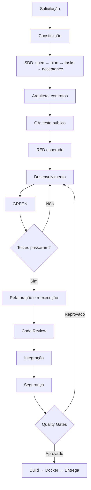
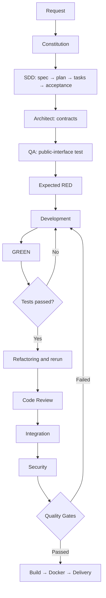

# Fluxo de desenvolvimento / Development workflow

### 🇧🇷 Descrição em Português

<strong>Ver Detalhes</strong>

## Spec-to-Production Engineering
O requisito percorre uma cadeia verificável: requisito → aceitação → tarefa → teste → implementação → resultado → gate. A constituição centraliza regras; os agentes especializam responsabilidades; skills definem procedimentos reutilizáveis.

## Trabalho incremental
Cada feature em `specs/` começa com seus quatro artefatos. O teste atravessa uma interface pública acordada no prompt: regras/services, REST, máquina da simulação ou UI observável. RED só conta quando o comportamento está ausente; falha de compilação é preparação incompleta. GREEN exige execução real. Refatoração mantém o comportamento e reexecuta testes relevantes.

Os agentes reais podem trabalhar em paralelo em diretórios diferentes, mantendo contratos comuns. Arquivos compartilhados têm um único responsável. Revisão avalia padrões e especificação separadamente. A intervenção humana decide requisitos, risco e aceite; a automação torna as evidências repetíveis.

## Evidências e demonstração
O Studio mostra quatro roteiros previsíveis, inclusive falhas e retorno para correção. Sua indicação de simulação permanece visível. Logs demonstrativos não comprovam um teste real. `docs/validation.md`, relatórios Maven/Vitest/Playwright e CI são fontes de resultados reais. Uma execução ausente ou falha continua pendente; não é substituída por métricas de cenário.

## Comandos
Use os scripts dos manifests e o pipeline de `.github/workflows/ci.yml`. Backend executa `./mvnw verify`; frontend executa `npm run lint`, `npm run typecheck`, `npm run test:coverage` e `npm run build`. Os detalhes de infraestrutura estão no README.

### 🇺🇸 English Description

<strong>View Details</strong>

## Spec-to-Production Engineering
A requirement follows a verifiable chain: requirement → acceptance → task → test → implementation → result → gate. The constitution centralizes rules; agents specialize responsibilities; skills define reusable procedures.

## Incremental work
Each feature under `specs/` starts with its four artifacts. Tests cross public interfaces agreed in the request: rules/services, REST, the simulation machine or observable UI. RED counts only when behavior is missing; compilation failure is incomplete setup. GREEN requires real execution. Refactoring preserves behavior and reruns relevant tests.

Real agents can work in parallel in separate directories with shared contracts. Shared files have one owner. Review evaluates standards and specification separately. Humans decide requirements, risk and acceptance; automation makes evidence repeatable.

## Evidence and demonstration
The Studio displays four predictable scripts, including failures and correction loops. Its simulation label stays visible. Demonstration logs do not prove real testing. `docs/validation.md`, Maven/Vitest/Playwright reports and CI provide real results. Missing or failed executions stay pending; scenario metrics do not replace them.

## Commands
Use manifest scripts and `.github/workflows/ci.yml`. The backend runs `./mvnw verify`; the frontend runs `npm run lint`, `npm run typecheck`, `npm run test:coverage` and `npm run build`. Infrastructure details are in the README.

