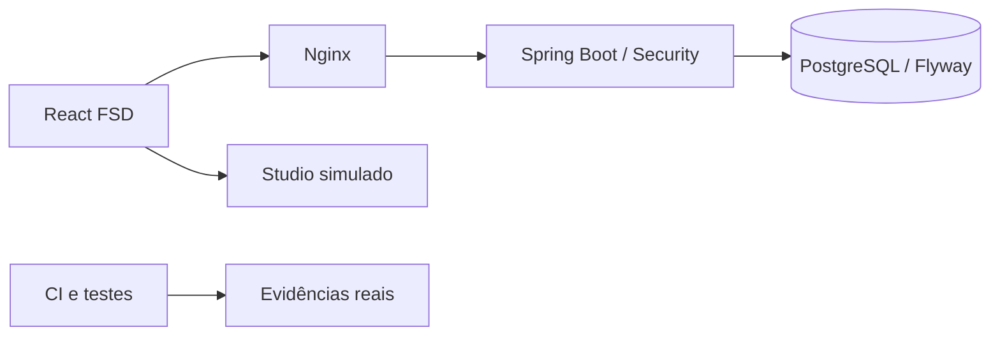
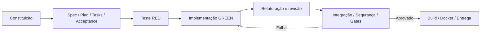
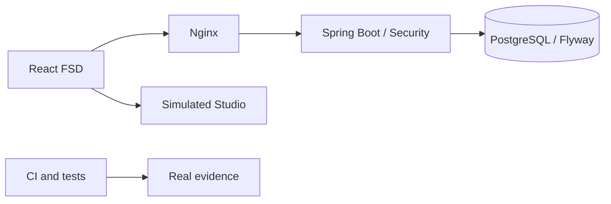
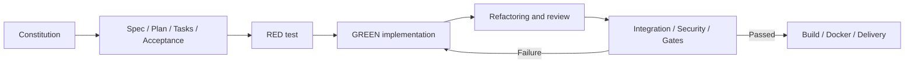

# Roteiro de apresentação / Presentation guide

### 🇧🇷 Descrição em Português

<strong>Ver Detalhes</strong>

## Preparação
Execute o README, confirme health e abra o Studio, a biblioteca e o Swagger. Use credenciais configuradas localmente; não projete o arquivo .env nem tokens. Tenha um usuário READER e uma sessão administrativa configurados. Consulte [validação](validation.md) antes de mencionar resultados. Nunca substitua evidência faltante por uma métrica da simulação.

## Cinco minutos
| Tempo | Demonstração | Mensagem |
|---|---|---|
| 0:00–0:40 | Problema e proposta | Geração de código sem critérios pode acelerar retrabalho. Spec-to-Production Engineering estabelece requisitos, limites e aprovação verificável. |
| 0:40–1:20 | Constituição e spec de ISBN | A regra existe antes do código. Aceitação explica o resultado observável, e skills tornam o procedimento reutilizável. |
| 1:20–2:40 | Studio: Play no cenário ISBN duplicado, velocidade 2x | Identifique o modo simulado. Mostre RED, implementação, reprovação, retorno ao desenvolvedor, GREEN e gates posteriores. |
| 2:40–3:40 | CRUD real | Crie um livro, pesquise, edite disponibilidade e provoque conflito de ISBN. O servidor valida mesmo que o cliente seja alterado. |
| 3:40–4:30 | Swagger e evidências | Mostre contrato JWT, erro Problem Details e relatórios reais; destaque gates ainda pendentes quando houver. |
| 4:30–5:00 | Conclusão e validação humana | Governança e rastreabilidade reduzem ambiguidade; revisão humana decide o aceite. Não há promessa numérica de produtividade. |

## Quinze minutos
| Tempo | Conteúdo |
|---|---|
| 0–2 min | Problema, escopo de acervo, arquitetura e critérios de sucesso. |
| 2–4 min | Constituição, agentes especializados, skills e os quatro artefatos SDD. |
| 4–7 min | Studio: sucesso e falha de ISBN; pause, selecione nó, leia artefato, avance e retorne; retome reprodução e altere velocidade. |
| 7–9 min | Cenários de segurança e Quality Gate: testes unitários não autorizam entrega sozinhos. Mostre correção e revalidação simuladas. |
| 9–12 min | CRUD real, filtros/paginação, dashboard da API e READER impedido de escrever; usuário público nunca escolhe ADMIN. |
| 12–14 min | Swagger, coleção Postman, Compose e pipeline; abra relatórios de testes/cobertura e explique limites do ambiente. |
| 14–15 min | Rastreabilidade, segurança, redução de retrabalho esperada e decisões humanas. |

## Falas e cuidados
“Minha proposta combina especificações, testes antes da implementação e gates automatizados para tornar o desenvolvimento verificável.” Ao abrir o Studio diga: “Esta é uma simulação educacional do processo; os resultados reais ficam nos relatórios do projeto.” Somente após validar a execução diga que backend, frontend, banco e fluxo foram demonstrados funcionalmente.

No Postman importe coleção e ambiente, configure valores locais e execute Authentication → Books → Validation → Security → Health. Observe 201, 400, 401, 403 e 409 conforme o caso. Logout revoga refresh; o limite do access token é explicado em [segurança](security.md).

## Diagramas
Arquitetura:

Processo:

## Se uma demonstração falhar
Preserve a mensagem, explique qual gate bloqueou o avanço e mostre o critério correspondente. Não altere testes para ocultar a falha. Se Docker não estiver disponível, o Studio continua demonstrável, mas não representa validação da integração real.

### 🇺🇸 English Description

<strong>View Details</strong>

## Preparation
Follow the README, confirm health and open the Studio, library and Swagger. Use locally configured credentials; do not project .env files or tokens. Prepare a READER user and an administrative session. Read [validation](validation.md) before citing results. Never replace missing evidence with simulation metrics.

## Five minutes
| Time | Demonstration | Message |
|---|---|---|
| 0:00–0:40 | Problem and proposal | Code generation without criteria may accelerate rework. Spec-to-Production Engineering defines requirements, boundaries and verifiable approval. |
| 0:40–1:20 | Constitution and ISBN spec | The rule exists before the code. Acceptance describes observable outcomes; skills make procedures reusable. |
| 1:20–2:40 | Studio: Play duplicate ISBN scenario at 2x | Identify simulated mode. Show RED, implementation, failure, return to the developer, GREEN and subsequent gates. |
| 2:40–3:40 | Real CRUD | Create a book, search, edit availability and trigger an ISBN conflict. Server validation holds even if the client changes. |
| 3:40–4:30 | Swagger and evidence | Show JWT contracts, Problem Details and real reports; identify any pending gates. |
| 4:30–5:00 | Conclusion and human validation | Governance and traceability reduce ambiguity; human review decides acceptance. Make no numerical productivity promise. |

## Fifteen minutes
| Time | Content |
|---|---|
| 0–2 min | Problem, catalog scope, architecture and success criteria. |
| 2–4 min | Constitution, specialized agents, skills and four SDD artifacts. |
| 4–7 min | Studio: success and ISBN failure; pause, select a node, read its artifact, step forward/back; resume and change speed. |
| 7–9 min | Security and Quality Gate scenarios: unit tests alone do not authorize delivery. Show simulated correction and revalidation. |
| 9–12 min | Real CRUD, filters/pagination, API dashboard and READER write denial; public users never select ADMIN. |
| 12–14 min | Swagger, Postman, Compose and pipeline; open test/coverage reports and explain environment limits. |
| 14–15 min | Traceability, security, expected rework reduction and human decisions. |

## Suggested wording and care
“My proposal combines specifications, tests before implementation and automated gates to make development verifiable.” When opening the Studio say: “This is an educational process simulation; real results live in project reports.” Claim functional backend, frontend, database and workflow demonstration only after validating execution.

In Postman import the collection/environment, configure local values and run Authentication → Books → Validation → Security → Health. Observe 201, 400, 401, 403 and 409 as appropriate. Logout revokes refresh; the access-token limit is explained in [security](security.md).

## Diagrams
Architecture:

Process:

## If a demonstration fails
Preserve the message, explain which gate blocked progress and show its criterion. Never alter tests to hide failure. If Docker is unavailable, the Studio can still be demonstrated, but it does not validate real integration.

